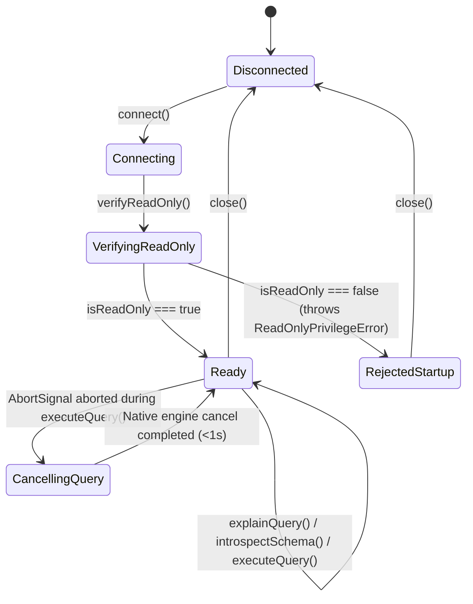

# Data Model: Base Arquitectónica de Adaptadores y Suite Adversaria de Seguridad

**Feature**: `001-adapters-adversarial-suite`
**Date**: 2026-10-30

## 1. Entidades del Contrato de Adaptador (`DatabaseAdapter`)

### 1.1 `SqlDialect`
Identificador del dialecto relacional soportado por un adaptador o evaluado en el corpus.
- **Valores permitidos**: `'tsql' | 'postgres' | 'common'`

### 1.2 `ReadOnlyVerificationResult`
Resultado de la operación de verificación de permisos de solo lectura en el arranque (*preflight check*, `FR-003`).

| Campo | Tipo | Obligatorio | Descripción y Reglas de Validación |
| --- | --- | --- | --- |
| `isReadOnly` | `boolean` | Sí | `true` únicamente si `violations.length === 0`. |
| `principalName` | `string` | Sí | Nombre del usuario o inicio de sesión verificado en el motor. |
| `sessionReadOnlyEnforced` | `boolean` | Sí | Indica si el adaptador activó además el bloqueo de sesión en modo solo lectura. |
| `violations` | `string[]` | Sí | Lista descriptiva de permisos de escritura, DDL o roles privilegiados detectados. |
| `checkedAt` | `string` (ISO-8601) | Sí | Marca de tiempo UTC de la verificación. |

### 1.3 `NormalizedRiskProfile`
Perfil común y normalizado resultante de analizar el plan de ejecución estimado sin ejecutar la consulta (`FR-004`, `FR-005`).

| Campo | Tipo | Obligatorio | Descripción y Reglas de Validación |
| --- | --- | --- | --- |
| `hasFullScan` | `boolean` | Sí | `true` si el plan incluye escaneo secuencial/completo de tabla sin índice de búsqueda. |
| `hasUnconditionalJoin` | `boolean` | Sí | `true` si existe al menos un *join* sin predicado de unión (producto cartesiano). |
| `estimatedRows` | `number` | Sí | Número entero o decimal `>= 0` de filas estimadas en la raíz del plan. |
| `estimatedCost` | `number` | Sí | Costo numérico nativo reportado por el optimizador del motor (`>= 0`). |
| `rawPlanSummary` | `string` | No | Resumen estructural sanitizado de los operadores del plan para diagnóstico/auditoría. |

### 1.4 `QueryParameter` y `ParameterizedQuery`
Representación estricta de una consulta `SELECT` validada cuyos valores viajan separados del texto SQL (`FR-006`, Principio III).

| Campo | Tipo | Obligatorio | Descripción y Reglas de Validación |
| --- | --- | --- | --- |
| `sql` | `string` | Sí | Sentencia `SELECT` validada previamente por el guard AST (no vacía). |
| `params` | `ReadonlyArray<QueryParameter>` | Sí | Lista inmutable de parámetros tipados (`name`, `type`, `value`). |
| `signal` | `AbortSignal` | No | Señal estándar para disparar la cancelación nativa en el motor (`SC-003`). |
| `maxRows` | `number` | No | Tope opcional de filas a recuperar (`> 0`). |

Tipos escalares soportados en `QueryParameter.type`:
- `'string' | 'number' | 'boolean' | 'date' | 'null'`

### 1.5 `QueryExecutionResult`
Respuesta normalizada de una consulta parametrizada ejecutada por el adaptador.

| Campo | Tipo | Obligatorio | Descripción |
| --- | --- | --- | --- |
| `columns` | `ReadonlyArray<{ name: string; dataType: string }>` | Sí | Metadatos de las columnas devueltas. |
| `rows` | `ReadonlyArray<Record<string, unknown>>` | Sí | Filas crudas obtenidas del motor (antes de pasar por la capa de enmascaramiento del núcleo). |
| `rowCount` | `number` | Sí | Cantidad de filas devueltas (`>= 0`). |
| `durationMs` | `number` | Sí | Tiempo de ejecución medido en milisegundos (`>= 0`). |

### 1.6 `SchemaCatalog`
Estructura normalizada devuelta por la operación de introspección de esquema (`FR-007`).

| Entidad / Subentidad | Campos Clave | Reglas |
| --- | --- | --- |
| `SchemaCatalog` | `databaseName: string`, `tables: TableMetadata[]`, `foreignKeys: ForeignKeyMetadata[]`, `inspectedAt: string` | Obtenido exclusivamente de vistas de catálogo sin leer filas de usuario. |
| `TableMetadata` | `schema: string`, `name: string`, `kind: 'TABLE' \| 'VIEW'`, `columns: ColumnMetadata[]`, `primaryKeyColumns: string[]` | Identifica tablas y vistas accesibles. |
| `ColumnMetadata` | `name: string`, `dataType: string`, `isNullable: boolean`, `ordinalPosition: number` | Describe cada columna de la tabla o vista. |
| `ForeignKeyMetadata` | `constraintName: string`, `sourceSchema: string`, `sourceTable: string`, `sourceColumn: string`, `targetSchema: string`, `targetTable: string`, `targetColumn: string` | Relaciones declaradas en el catálogo. |

---

## 2. Entidades del Corpus Adversario (`AdversarialCorpus`)

### 2.1 `AttackVectorId`
Enumeración de los 10 vectores obligatorios (`FR-011`):
1. `V01_STACKED_QUERIES` — Consultas encadenadas con `;`.
2. `V02_SELECT_INTO` — Creación encubierta de tablas con `SELECT INTO`.
3. `V03_COMMENT_OBFUSCATION` — Comentarios inline (`--`) o de bloque (`/* */`) fuera de literales.
4. `V04_MUTATING_CTE` — CTEs con escritura (`WITH ... INSERT/UPDATE/DELETE RETURNING`).
5. `V05_DANGEROUS_FUNCTIONS` — Funciones administrativas o de acceso a archivos (`pg_terminate_backend`, `pg_read_file`, etc.).
6. `V06_EXPLICIT_LOCKING` — Bloqueo explícito de filas o tablas (`SELECT ... FOR UPDATE`, `FOR SHARE`, hints `UPDLOCK`/`TABLOCKX`).
7. `V07_REMOTE_LINKED_ACCESS` — Evasión hacia servidores vinculados (`OPENQUERY`, `OPENROWSET`, `OPENDATASOURCE`, nombres de 4 partes).
8. `V08_TSQL_IMPLICIT_EXEC` — Ejecución de procedimientos en T-SQL sin punto y coma (`SELECT 1 EXEC ...`).
9. `V09_DELAY_DOS` — Denegación de servicio por retardo (`WAITFOR DELAY`, `WAITFOR TIME`, `pg_sleep`).
10. `V10_SESSION_OR_INTERNAL_CMD` — Alteración de sesión o comandos internos (`SET ...`, `DBCC ...`).

### 2.2 `AdversarialTestCase`
Registro individual dentro de `corpus/adversarial-attacks.json` (`FR-010`).

| Campo | Tipo | Obligatorio | Reglas de Validación |
| --- | --- | --- | --- |
| `id` | `string` | Sí | Identificador único (ej. `ADV-V01-001` o `CTL-SEL-001`). |
| `vector` | `AttackVectorId \| 'CONTROL_VALID_SELECT'` | Sí | Vector de ataque (1 al 10) o caso de control legítimo. |
| `dialect` | `'tsql' \| 'postgres' \| 'common'` | Sí | Dialecto objetivo de la prueba. |
| `description` | `string` | Sí | Descripción clara del intento de ataque o consulta legítima. |
| `sql` | `string` | Sí | Payload SQL a evaluar. |
| `expectedOutcome` | `'REJECT' \| 'ALLOW'` | Sí | `'REJECT'` para todos los casos de los vectores 1 a 10; `'ALLOW'` para casos de control. |
| `expectedReasonCode` | `string` | Condicional | Obligatorio cuando `expectedOutcome === 'REJECT'`. |

## 3. Transiciones de Estado del Adaptador

