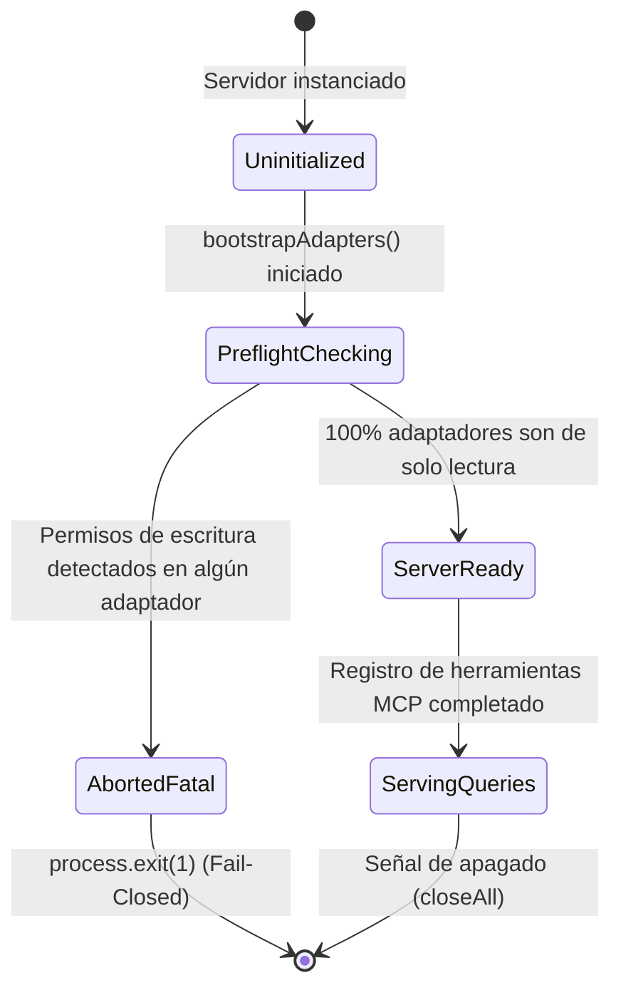

# Data Model: Seguridad del Servidor MCP: Guardián de Consultas SQL, Verificación Preflight, Enmascaramiento de Datos y Defensa Zero-Trust

**Feature**: `002-mcp-security-guard`  
**Date**: 2026-10-30  

---

## 1. Entidades del Guardián Sintáctico de Seguridad (SQL AST Guard)

### 1.1 `QueryValidationRequest`
Representa una solicitud de validación de consulta entrante antes de interactuar con el motor relacional.

| Campo | Tipo | Obligatorio | Descripción |
| --- | --- | --- | --- |
| `sql` | `string` | Sí | Cadena con la sentencia SQL a inspeccionar. |
| `dialect` | `'tsql' \| 'postgres' \| 'common'` | Sí | Dialecto SQL esperado por el adaptador de destino. |
| `params` | `ReadonlyArray<QueryParameter>` | No | Lista de parámetros tipados suministrados para la consulta. |

### 1.2 `SecurityViolationCode`
Códigos tipados y estandarizados que categorizan el motivo exacto de rechazo de una consulta maliciosa o inválida.

```typescript
export type SecurityViolationCode =
  | 'V01_STACKED_QUERIES'          // Consultas encadenadas con punto y coma
  | 'V02_SELECT_INTO'              // Creación de tabla oculta con SELECT INTO
  | 'V03_COMMENT_OBFUSCATION'      // Comentarios -- o /* */ fuera de literales
  | 'V04_MUTATING_CTE'             // Cláusula WITH con INSERT, UPDATE o DELETE
  | 'V05_FORBIDDEN_FUNCTION'       // Funciones administrativas o de lectura de archivos
  | 'V06_MUTATING_DML'             // INSERT, UPDATE, DELETE o MERGE directo
  | 'V07_DDL_COMMAND'              // CREATE, DROP, ALTER, TRUNCATE
  | 'V08_PROCEDURE_CALL'           // EXEC, EXECUTE, CALL o sp_executesql
  | 'V09_TRANSACTION_CONTROL'      // COMMIT, ROLLBACK, BEGIN TRANSACTION
  | 'V10_SESSION_COMMAND'          // SET, DBCC, RECONFIGURE
  | 'SYNTAX_ERROR'                 // Sintaxis SQL no válida para el parser AST
  | 'EMPTY_QUERY';                 // Consulta vacía o solo espacios
```

### 1.3 `SqlValidationResult` y `SecurityViolation`
Entidad que representa el veredicto del análisis en dos etapas (léxico + AST).

| Campo | Tipo | Obligatorio | Descripción |
| --- | --- | --- | --- |
| `allowed` | `boolean` | Sí | `true` si la consulta es un `SELECT` de solo lectura puro; `false` en caso de violación. |
| `reasonCode` | `SecurityViolationCode` | No | Código de la violación detectada (obligatorio si `allowed === false`). |
| `message` | `string` | No | Mensaje seguro para el cliente explicando la causa sin revelar esquemas. |
| `nodeType` | `string` | No | Nombre del nodo sintáctico infractor en el AST (`into`, `with_dml`, `call`, etc.). |
| `detectedInStage` | `'lexical' \| 'ast'` | No | Etapa de la tubería donde se identificó la infracción. |

---

## 2. Entidades de la Verificación Previa de Arranque (Preflight Check & Startup Gate)

### 2.1 `PreflightAdapterReport`
Registro inmutable del resultado de inspección de permisos efectivos en una base de datos conectada.

| Campo | Tipo | Obligatorio | Descripción |
| --- | --- | --- | --- |
| `adapterId` | `string` | Sí | Identificador único del adaptador verificado. |
| `dialect` | `'tsql' \| 'postgres'` | Sí | Motor evaluado. |
| `principalName` | `string` | Sí | Usuario de base de datos verificado en el catálogo. |
| `isReadOnly` | `boolean` | Sí | `true` si carece de cualquier permiso de modificación o rol de escritura. |
| `violations` | `ReadonlyArray<string>` | Sí | Lista descriptiva de permisos o roles infractores (`INSERT`, `UPDATE`, `db_datawriter`, etc.). |
| `checkedAt` | `string` (ISO-8601) | Sí | Marca de tiempo UTC de la verificación previa. |

### 2.2 `ServerPreflightSummary`
Estado consolidado del arranque del servidor antes de admitir solicitudes de clientes.

| Campo | Tipo | Obligatorio | Descripción |
| --- | --- | --- | --- |
| `allPassed` | `boolean` | Sí | `true` si el 100% de los adaptadores registrados superaron la verificación. |
| `totalAdapters` | `number` | Sí | Cantidad total de adaptadores evaluados. |
| `reports` | `ReadonlyArray<PreflightAdapterReport>` | Sí | Reportes individuales de cada adaptador. |
| `abortedProcess` | `boolean` | Sí | `true` si el servidor ejecutó el aborto fatal (`process.exit(1)`). |

---

## 3. Entidades del Motor de Enmascaramiento de Datos (Data Masking Engine)

### 3.1 `SensitiveDataType` y `MaskingStrategy`
Tipología de datos sensibles reconocidos y estrategias de ofuscación admitidas:

```typescript
export type SensitiveDataType =
  | 'email'       // Direcciones de correo electrónico
  | 'phone'       // Números de teléfono fijos y móviles
  | 'dpi'         // Documento Personal de Identificación (13 dígitos Guatemala)
  | 'amount'      // Montos monetarios y salarios
  | 'custom';     // Reglas de negocio personalizadas

export type MaskingStrategy =
  | 'partial'     // Ofuscación parcial conservando formato (ej. j***z@dominio.com, *********0101)
  | 'redact'      // Reemplazo completo por token (ej. [REDACTED], [CONFIDENCIAL])
  | 'mask_amount' // Reemplazo con símbolo de moneda (ej. Q [ENMASCARADO] o Q ***.00)
  | 'custom';     // Función transformadora personalizada
```

### 3.2 `MaskingRule`
Definición declarativa de una regla de enmascaramiento configurada por un administrador.

| Campo | Tipo | Obligatorio | Descripción y Validación |
| --- | --- | --- | --- |
| `id` | `string` | Sí | Identificador alfanumérico único de la regla (ej. `rule-email-pattern`). |
| `targetType` | `'column_name' \| 'content_pattern'` | Sí | Determina si la regla busca nombres de campo o inspecciona el valor de las celdas. |
| `matcher` | `string \| RegExp` | Sí | Nombre/patrón de columna o expresión regular sobre el valor de la celda. |
| `dataType` | `SensitiveDataType` | Sí | Categoría de dato sensible asociada. |
| `strategy` | `MaskingStrategy` | Sí | Estrategia de transformación aplicada sobre la coincidencia. |
| `customMask` | `string` | No | Texto de reemplazo personalizado si `strategy === 'redact'`. |
| `enabled` | `boolean` | Sí | Permite activar o desactivar la regla dinámicamente. |

### 3.3 `MaskingProfile`
Conjunto jerárquico de reglas de enmascaramiento activo en el servidor.

| Campo | Tipo | Obligatorio | Descripción |
| --- | --- | --- | --- |
| `profileName` | `string` | Sí | Nombre descriptivo de la política (ej. `default-security-profile`). |
| `rules` | `ReadonlyArray<MaskingRule>` | Sí | Lista ordenada de reglas de enmascaramiento a evaluar. |
| `maskUnmatchedAmounts` | `boolean` | Sí | Si está activado, enmascara heurísticamente columnas con indicios numéricos de moneda. |

### 3.4 `MaskedDataset`
Resultado del proceso de enmascaramiento en memoria volátil listo para encapsular.

| Campo | Tipo | Obligatorio | Descripción |
| --- | --- | --- | --- |
| `columns` | `ReadonlyArray<{ name: string; dataType: string }>` | Sí | Metadatos de columnas originales. |
| `rows` | `ReadonlyArray<Record<string, unknown>>` | Sí | Filas con valores sensibles ofuscados en memoria (los reales fueron descartados). |
| `rowCount` | `number` | Sí | Número total de filas procesadas. |
| `maskedCellsCount` | `number` | Sí | Conteo de celdas individuales sobre las cuales se aplicó una regla de enmascaramiento. |
| `durationMs` | `number` | Sí | Tiempo de procesamiento del enmascaramiento en milisegundos. |

---

## 4. Entidades de Defensa Zero-Trust y Filas Maliciosas

### 4.1 `ZeroTrustEncapsulationOptions` y `EncapsulatedDataOutput`
Configuración del empaquetado estructural para el cliente MCP y modelo de lenguaje.

| Campo | Tipo | Obligatorio | Descripción |
| --- | --- | --- | --- |
| `format` | `'semantic_xml' \| 'strict_json'` | Sí | Estilo de delimitación estructural utilizado. |
| `neutralizeDirectives` | `boolean` | Sí | Si es `true`, prefija directivas de IA detectadas (`SYSTEM:`, `[INST]`) con `[DATA_LITERAL]:`. |
| `escapeControlChars` | `boolean` | Sí | Si es `true`, reemplaza caracteres ASCII de control peligrosos. |

### 4.2 `AdversarialRowTestCase`
Entidad que modela un caso de prueba del corpus de datos adversarios (`corpus/adversarial-rows.json`).

| Campo | Tipo | Obligatorio | Descripción |
| --- | --- | --- | --- |
| `id` | `string` | Sí | Identificador del caso de prueba (ej. `ROW-001`). |
| `category` | `string` | Sí | Vector de ataque: `R01_PROMPT_INJECTION`, `R02_DELIMITER_BREAK`, `R03_CONTROL_CHARS`, `R04_FORMAT_SPOOFING`, `R05_SPECIAL_TOKENS`. |
| `description` | `string` | Sí | Explicación del vector de inyección indirecta evaluado. |
| `maliciousCellContent` | `string` | Sí | Carga útil simulada en la celda de base de datos. |
| `columnName` | `string` | Sí | Nombre de la columna en la que reside el dato malicioso. |
| `expectedInOutput` | `string` | Sí | Secuencia que DEBE aparecer en la salida (neutralizada o escapada). |
| `forbiddenInOutput` | `string` | Sí | Secuencia cruda que NUNCA debe aparecer (evasión de delimitador o directiva pura). |

---

## 5. Máquinas de Estados y Transiciones de Ciclo de Vida

### 5.1 Ciclo de Vida del Servidor (Compuerta Preflight)



### 5.2 Tubería de Ejecución Segura de Consultas (`query_database`)

```mermaid
stateDiagram-v2
    [*] --> RequestReceived: Solicitud de consulta con SQL y parámetros
    RequestReceived --> LexicalScan: Escaneo léxico consciente de cadenas
    LexicalScan --> SecurityViolationState: Comentarios (-- o /* */) o punto y coma encadenado
    LexicalScan --> AstParsing: Estructura léxica limpia
    AstParsing --> SecurityViolationState: No-SELECT / Mutating CTE / SELECT INTO / EXEC / Función prohibida
    AstParsing --> EngineExecution: Consulta aprobada como SELECT puro
    EngineExecution --> InProcessMemory: Filas crudas recuperadas en memoria volátil
    InProcessMemory --> DataMasking: Aplicación de reglas por columna y patrón (Email, DPI, Tel, Monto)
    DataMasking --> ZeroTrustPackaging: Celdas reales destruidas; filas enmascaradas
    ZeroTrustPackaging --> McpResponse: Encapsulamiento estructural delimitado semánticamente
    SecurityViolationState --> McpResponse: Error estructurado sin fuga de esquema
    McpResponse --> [*]: Respuesta enviada al cliente MCP
```


