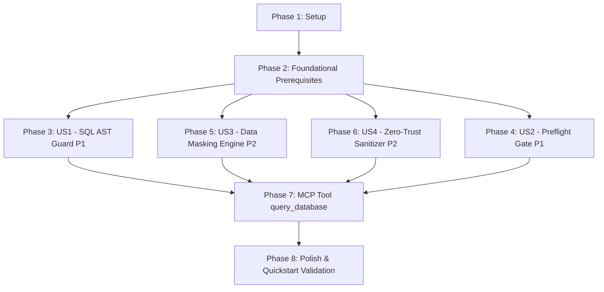

---

description: "Task list for Seguridad del Servidor MCP: Guardián de Consultas SQL, Verificación Preflight, Enmascaramiento de Datos y Defensa Zero-Trust"
---

# Tasks: Seguridad del Servidor MCP: Guardián de Consultas SQL, Verificación Preflight, Enmascaramiento de Datos y Defensa Zero-Trust

**Input**: Design documents from `/specs/002-mcp-security-guard/`

**Prerequisites**: [plan.md](./plan.md) (required), [spec.md](./spec.md) (required for user stories), [research.md](./research.md), [data-model.md](./data-model.md), [contracts/](./contracts/)

**Tests**: Included as mandatory deliverables required by `spec.md` (`FR-024`), the Project Constitution (Principle VI: *Desarrollo Guiado por Pruebas Adversarias*), and acceptance criteria (`SC-001` a `SC-007`).

**Organization**: Tasks are grouped by user story to enable independent implementation and testing of each story.

## Format: `[ID] [P?] [Story] Description`

- **[P]**: Can run in parallel (different files, no dependencies)
- **[Story]**: Which user story this task belongs to (e.g., `[US1]`, `[US2]`, `[US3]`, `[US4]`)
- Includes exact file paths and verbatim data-model constraints in descriptions

## Path Conventions

- **Single modular project**: `src/contracts/`, `src/core/security/`, `src/core/validation/`, `corpus/`, `tests/` at repository root

---

## Phase 1: Setup (Shared Infrastructure)

**Purpose**: Preparación de scripts npm y configuración para pruebas de seguridad, enmascaramiento y filas adversarias.

- [X] T001 Add security test scripts (`test:security`, `test:masking`, `test:adversarial-rows`) to `package.json`
- [X] T002 [P] Verify and update TypeScript path configurations and module resolutions in `tsconfig.json`

---

## Phase 2: Foundational (Blocking Prerequisites)

**Purpose**: Contratos formales en TypeScript estricto, jerarquía de errores tipados de seguridad y esquemas de validación que bloquean todas las historias de usuario.

**⚠️ CRITICAL**: Ninguna historia de usuario puede comenzar hasta completar esta fase.

- [X] T003 Implement security contracts and domain interfaces (`ISqlSecurityGuard`, `IStartupPreflightGate`, `IDataMaskingEngine`, `IZeroTrustSanitizer`, `SecurityViolationCode` covering `V01_STACKED_QUERIES` to `V10_SESSION_COMMAND` plus `SYNTAX_ERROR` and `EMPTY_QUERY`, `SecurityViolation`, `MaskingRule` with `targetType: 'column_name' | 'content_pattern'`, `MaskingProfile`, `MaskedDataset` with `rowCount >= 0` and `maskedCellsCount >= 0`, `DelimitedOutputFormat` as `'semantic_xml' | 'strict_json'`, and `EncapsulatedDataOutput`) in `src/contracts/security.contract.ts`
- [X] T004 [P] Implement structured security error classes (`SqlSecurityViolationError` carrying `SecurityViolationCode`, `PreflightFatalError` detailing write privileges, and `DataMaskingError`) preventing any database engine credential or schema leakage in `src/core/errors.ts`
- [X] T005 [P] Create declarative masking configuration schema and validator enforcing `targetType in ['column_name', 'content_pattern']`, `dataType in ['email', 'phone', 'dpi', 'amount', 'custom']`, and `strategy in ['partial', 'redact', 'mask_amount', 'custom']` in `src/core/security/masking-rules.ts`

**Checkpoint**: Contratos base, tipos de error y esquemas de enmascaramiento listos — la implementación de historias de usuario puede comenzar.

---

## Phase 3: User Story 1 - Filtrado Estricto de Consultas Mediante Análisis Sintáctico (AST Guard) (Priority: P1) 🎯 MVP

**Goal**: Toda consulta SQL entrante pasa por un guardián de análisis sintáctico que rechaza de forma absoluta cualquier sentencia que no sea un `SELECT` de solo lectura puro: sentencias encadenadas con punto y coma (`;`), comentarios `--` y `/* */` fuera de literales, CTEs mutantes (`WITH ... DELETE/UPDATE RETURNING`), `SELECT INTO`, llamadas a procedimientos (`EXEC`, `CALL`) y funciones administrativas prohibidas.

**Independent Test**: Ejecutar `npx vitest run tests/unit/sql-security-guard.spec.ts` comprobando el rechazo del 100% de consultas maliciosas con su código de razón (`SecurityViolationCode`) y la aceptación del 100% de consultas `SELECT` legítimas complejas (`SC-001`, `SC-002`).

### Tests for User Story 1 ⚠️

- [X] T006 [P] [US1] Write unit tests for `SqlSecurityGuard` testing strict rejection of stacked queries with `;` (`V01_STACKED_QUERIES`), `SELECT INTO` (`V02_SELECT_INTO`), inline `--` and block `/* */` comments outside string literals (`V03_COMMENT_OBFUSCATION`), mutating CTEs with `DELETE/UPDATE/INSERT RETURNING` (`V04_MUTATING_CTE`), forbidden administrative functions like `pg_terminate_backend` and `xp_cmdshell` (`V05_FORBIDDEN_FUNCTION`), implicit and explicit procedure calls `EXEC`/`CALL` (`V08_PROCEDURE_CALL`), and validating 0 false positives for valid complex `SELECT` queries with joins and subqueries in `tests/unit/sql-security-guard.spec.ts`

### Implementation for User Story 1

- [X] T007 [US1] Implement `SqlSecurityGuard` coordinating the 2-stage verification pipeline: Stage 1 string-aware lexical scanner (`lexical-scanner.ts`) for comments and stacked queries + Stage 2 AST inspection via `node-sql-parser` for dialect-specific syntax (`TransactSQL` and `Postgresql`), ensuring single-statement root `SELECT`, no `into` clause, no mutating CTEs, no procedure calls, and no blacklisted system functions in `src/core/security/sql-security-guard.ts`
- [X] T008 [US1] Integrate `SqlSecurityGuard` into `AdapterRegistry.validateAndExecute()` and `AdapterRegistry.validateAndExplain()` to reject unauthorized queries before database dispatch in `src/core/engine-registry.ts`

**Checkpoint**: User Story 1 completa e independientemente testeable; todas las consultas SQL quedan blindadas contra modificaciones y comandos no-SELECT.

---

## Phase 4: User Story 2 - Verificación Obligatoria de Solo Lectura en el Arranque (Preflight Check) (Priority: P1)

**Goal**: El servidor MCP comprueba automáticamente en el arranque los permisos efectivos del usuario de conexión en la base de datos y se niega a iniciar (*fail-closed*, `process.exit(1)`) si detecta permisos de escritura (`INSERT`, `UPDATE`, `DELETE`, `ALTER`, `DROP`, `CREATE`, etc.) o roles con capacidad modificadora, impidiendo el registro o exposición de herramientas de consulta hasta superar la verificación.

**Independent Test**: Ejecutar `npx vitest run tests/unit/startup-preflight-gate.spec.ts` comprobando el aborto fatal inmediato ante conexiones con permisos de escritura y el inicio exitoso sin restricciones ante conexiones estrictamente de solo lectura (`SC-003`).

### Tests for User Story 2 ⚠️

- [X] T009 [P] [US2] Write unit tests for `StartupPreflightGate` verifying that connections with read-only permissions pass successfully (`allPassed: true`), connections with write privileges (`INSERT`, `UPDATE`, `DELETE`, `db_datawriter`) abort process startup in `< 2s` with structured logs detailing violations, and MCP tool registration is blocked when preflight fails in `tests/unit/startup-preflight-gate.spec.ts`

### Implementation for User Story 2

- [X] T010 [US2] Implement `StartupPreflightGate` coordinating the preflight lifecycle: querying all registered adapters via `adapter.verifyReadOnly()`, verifying that `violations.length === 0`, formatting structured console error logs detailing each detected write permission, and executing `process.exit(1)` upon any failure (*fail-closed*) in `src/core/security/startup-preflight-gate.ts`
- [X] T011 [US2] Update `bootstrapAdapters()` and server startup in `src/index.ts` to execute `StartupPreflightGate.verifyAndEnforceStartup()` before exposing any MCP tools or initializing client listeners

**Checkpoint**: User Stories 1 y 2 completas; el servidor no admite consultas mutantes ni arranca si la cuenta de base de datos posee permisos de escritura.

---

## Phase 5: User Story 3 - Enmascaramiento Dinámico de Datos Sensibles en Memoria (Priority: P2)

**Goal**: Un administrador define reglas declarativas por nombre de columna o por patrón de contenido (expresiones regulares) para enmascarar correos, teléfonos, DPI de Guatemala de 13 dígitos y montos monetarios en memoria volátil dentro del proceso; el dato real nunca abandona el servidor MCP hacia clientes o logs.

**Independent Test**: Ejecutar `npx vitest run tests/unit/data-masking-engine.spec.ts` comprobando que las celdas con datos sensibles sean ofuscadas conservando formato o redactadas según la regla configurada, y que el valor real quede eliminado del resultado final (`SC-004`).

### Tests for User Story 3 ⚠️

- [X] T012 [P] [US3] Write unit tests for `DataMaskingEngine` verifying column-name matching (case-insensitive and partial match for `email`, `correo`, `telefono`, `phone`, `dpi`, `cui`, `monto`, `salario`), content-pattern regex matching for emails (`juan.perez@empresa.com.gt` -> `j***z@empresa.com.gt`), phone numbers (`(***) ***-1234`), Guatemala DPI 13-digit CUI (`*********0101`), and monetary amounts (`Q [ENMASCARADO]`), confirming 0 instances of raw data in output in `tests/unit/data-masking-engine.spec.ts`

### Implementation for User Story 3

- [X] T013 [P] [US3] Implement sensitive data formatters and default security profile with pre-configured rules for emails, phones, Guatemala DPI (`^\d{4}\s?\d{5}\s?\d{4}$`), and financial amounts (`Q [ENMASCARADO]`) in `src/core/security/default-masking-profile.ts`
- [X] T014 [US3] Implement `DataMaskingEngine` implementing `IDataMaskingEngine`: receiving raw `QueryExecutionResult.rows`, applying active `MaskingProfile` rules across columns and cell content in-memory, updating `maskedCellsCount`, and returning `MaskedDataset` with all sensitive values obscured before serialization in `src/core/security/data-masking-engine.ts`

**Checkpoint**: User Story 3 completa; los datos sensibles son ofuscados en memoria dentro del proceso y los valores reales nunca salen hacia el cliente MCP.

---

## Phase 6: User Story 4 - Defensa Zero-Trust y Manejo Seguro de Filas Maliciosas (Priority: P2)

**Goal**: Tratar todo el contenido de las filas como datos no confiables y literales inertes, encapsulando resultados en delimitadores estructurales semánticos, neutralizando caracteres de control y directivas de IA, y validando contra un corpus estructurado de filas maliciosas.

**Independent Test**: Ejecutar `npx vitest run tests/adversarial/malicious-rows.spec.ts` y `tests/unit/zero-trust-sanitizer.spec.ts` comprobando que el 100% de las filas del corpus adversario sean neutralizadas y entregadas como datos literales (`SC-005`).

### Tests for User Story 4 ⚠️

- [X] T015 [P] [US4] Create structured adversarial rows corpus with at least 15 attack cases covering all 5 categories (`R01_PROMPT_INJECTION`, `R02_DELIMITER_BREAK`, `R03_CONTROL_CHARS`, `R04_FORMAT_SPOOFING`, `R05_SPECIAL_TOKENS`, including system override prompts, unclosed tags, null bytes, and LLM special tokens) conforming to `adversarial-rows.schema.json` in `corpus/adversarial-rows.json`
- [X] T016 [P] [US4] Write unit tests for `ZeroTrustSanitizer` verifying structural encapsulation into `<database_records>` XML and strict JSON, control character escaping (ASCII 0-31), container closing tag neutralization (`</record>` -> `&lt;/record&gt;`), and prompt directive neutralizing prefixes in `tests/unit/zero-trust-sanitizer.spec.ts`
- [X] T017 [P] [US4] Write automated adversarial rows corpus runner validating that 100% of malicious test cases in `corpus/adversarial-rows.json` are sanitized such that `expectedInOutput` is present and `forbiddenInOutput` is completely absent in `tests/adversarial/malicious-rows.spec.ts`

### Implementation for User Story 4

- [X] T018 [US4] Implement `ZeroTrustSanitizer` implementing `IZeroTrustSanitizer`: taking `MaskedDataset`, escaping delimiter tags and control characters, neutralizing prompt injection directives with `[DATA_LITERAL]:` markers, and wrapping output in semantic data envelopes in `src/core/security/zero-trust-sanitizer.ts`

**Checkpoint**: User Story 4 completa; las filas de base de datos son neutralizadas contra inyección indirecta de prompts y delimitadas estructuralmente.

---

## Phase 7: Integration & MCP Tool Exposure

**Purpose**: Integración de la tubería completa de seguridad (`AST Guard` -> `Adapter Execution` -> `Data Masking` -> `Zero-Trust Sanitizer`) en el servidor MCP y exposición de la herramienta protegida `query_database`.

- [X] T019 [US1, US3, US4] Implement the secure MCP tool `query_database` in `src/index.ts` requiring `adapterId`, `sql`, and optional `params`, invoking `validateAndExecute()` with AST Guard, passing rows through `DataMaskingEngine`, and returning content encapsulated via `ZeroTrustSanitizer`
- [X] T020 [P] Write end-to-end integration tests for the `query_database` MCP tool verifying that valid queries return masked and structurally delimited data, non-SELECT queries are immediately rejected with MCP errors, and write-enabled configurations cannot start in `tests/contract/mcp-query-database.spec.ts`

---

## Phase 8: Polish & Cross-Cutting Concerns

**Purpose**: Verificación cruzada, exportaciones públicas y aseguramiento de compuertas de calidad.

- [X] T021 [P] Export all public security contracts, guards, gates, masking engines, and sanitizers in `src/index.ts`
- [X] T022 [P] Validate complete test suite and TypeScript compilation with `npm run typecheck` and `npx vitest run`
- [X] T023 Run and verify all scenarios in `specs/002-mcp-security-guard/quickstart.md`

---

## Dependencies & Execution Order

### Phase Dependencies

- **Setup (Phase 1)**: No dependencies — can start immediately.
- **Foundational (Phase 2)**: Depends on Setup — **BLOCKS all user stories**.
- **User Stories (Phases 3 to 6)**: All depend on Foundational phase completion:
  - **US1 (P1)**: Guardián AST — puede comenzar inmediatamente tras Foundational.
  - **US2 (P1)**: Preflight Check — puede desarrollarse en paralelo con US1 o secuencialmente.
  - **US3 (P2)**: Enmascaramiento — depende de contratos base de datos y puede desarrollarse en paralelo.
  - **US4 (P2)**: Zero-Trust y Filas Maliciosas — depende de contratos base y del corpus.
- **Integration (Phase 7)**: Depende de la finalización de US1, US3 y US4.
- **Polish (Phase 8)**: Depende de la finalización de todas las historias e integración.

---

## Parallel Opportunities

- **Foundational**: T004 (`errors.ts`) y T005 (`masking-rules.ts`) pueden implementarse en paralelo una vez redactado T003 (`security.contract.ts`).
- **User Story 1**: T006 (tests unitarios) se redacta antes y en paralelo a la especificación de T007 (`sql-security-guard.ts`).
- **User Story 2**: T009 (tests de preflight gate) y T010 (`startup-preflight-gate.ts`) avanzan en paralelo.
- **User Story 3**: T012 (tests de masking) y T013 (`default-masking-profile.ts`) avanzan en paralelo.
- **User Story 4**: T015 (corpus `adversarial-rows.json`) y T016 (tests unitarios de sanitización) avanzan en paralelo.
- **Historias de Usuario**: Una vez concluida la Fase 2 (Foundational), US1, US2, US3 y US4 pueden implementarse independientemente sin conflictos de archivos.

---

## Implementation Strategy

### MVP First (User Stories 1 y 2 - Solo Lectura Inquebrantable)

1. Completar Fase 1 (Setup) y Fase 2 (Foundational).
2. Implementar Fase 3 (US1: SQL AST Guard) y Fase 4 (US2: Startup Preflight Gate).
3. **VALIDACIÓN MVP**: Verificar que ninguna consulta no-SELECT pase el guardián y que el servidor aborte el inicio si el usuario tiene permisos de escritura.

### Incremento 2: Privacidad y Resiliencia Zero-Trust (User Stories 3 y 4)

1. Implementar Fase 5 (US3: Motor de Enmascaramiento de Datos Sensibles).
2. Implementar Fase 6 (US4: Sanitizador Zero-Trust y Batería de Filas Maliciosas).
3. Implementar Fase 7 (Integración de la herramienta MCP `query_database`).
4. **VALIDACIÓN COMPLETA**: Ejecutar la suite completa y validar todos los escenarios en `quickstart.md`.
