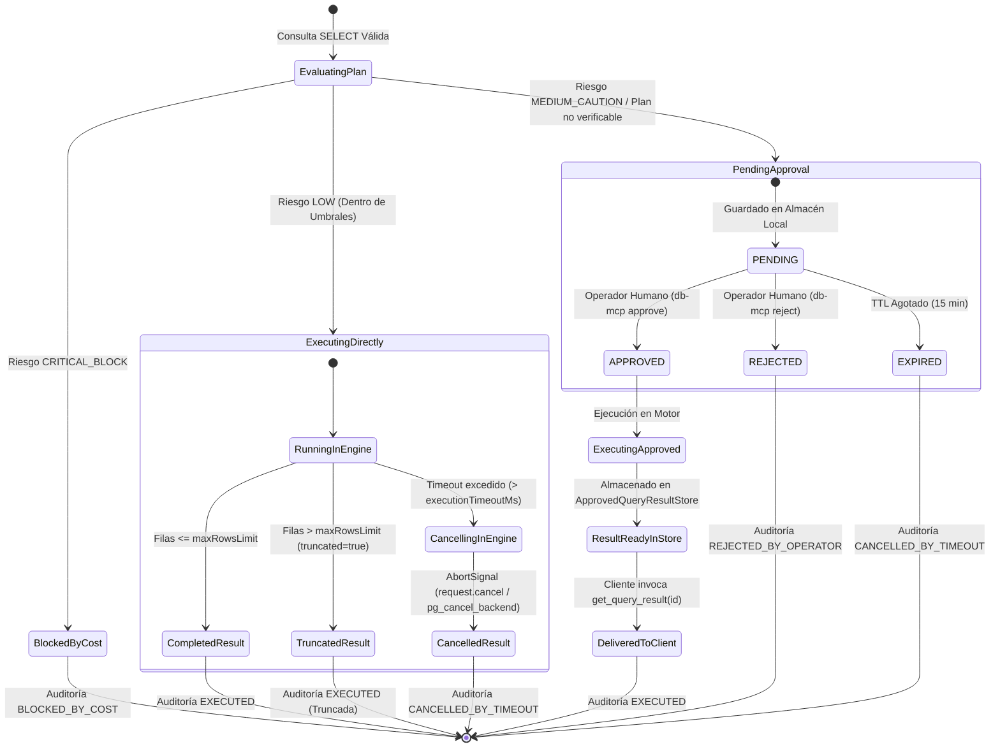

# Data Model: Control de Costo, Límites Operativos y Flujo de Aprobación Humana

**Feature**: `004-cost-limits-human-approval`  
**Date**: 2026-10-30  
**Status**: Completed  

---

## 1. Diagrama de Entidades y Ciclo de Vida

---

## 2. Entidades Principales

### 2.1. `RiskSeverity`
Enumeración que clasifica el nivel de impacto de una consulta evaluada a través de su plan de ejecución.
- Valores posibles:
  - `LOW`: Ejecución normal y segura.
  - `MEDIUM_CAUTION`: Supera umbrales de advertencia o plan no verificable; requiere autorización humana (`PENDING_APPROVAL`).
  - `CRITICAL_BLOCK`: Violación severa (escaneo en tabla grande, producto cartesiano o filas masivas); bloqueo absoluto (`BLOCKED_BY_COST`).

---

### 2.2. `QueryPlanRiskProfile`
Representación normalizada del perfil de riesgo de una consulta derivada de `EXPLAIN (FORMAT JSON)` en PostgreSQL o `SHOWPLAN` en SQL Server.

| Campo | Tipo | Obligatorio | Descripción |
|---|---|:---:|---|
| `severity` | `RiskSeverity` | Sí | Severidad asignada por el motor de evaluación. |
| `estimatedCost` | `number` | Sí | Costo computacional total estimado por el optimizador. |
| `estimatedRows` | `number` | Sí | Cantidad total estimada de registros procesados o devueltos. |
| `hasFullScan` | `boolean` | Sí | `true` si incluye al menos un escaneo completo de tabla o índice. |
| `scannedTables` | `string[]` | Sí | Lista de tablas sujetas a escaneo secuencial o de tabla. |
| `hasCartesianJoin` | `boolean` | Sí | `true` si incluye uniones sin condición de filtro o enlace. |
| `isVerifiable` | `boolean` | Sí | `false` si el plan no pudo obtenerse a tiempo (timeout 2s) o falló el parser. |
| `warnings` | `string[]` | Sí | Lista explicativa de razones de riesgo detectadas. |
| `rawPlanSummary` | `string` | No | Resumen compacto o extracto del nodo raíz del plan. |

---

### 2.3. `EngineRiskThresholds`
Umbrales y políticas de riesgo configurables por motor relacional.

| Campo | Tipo | Predeterminado | Descripción |
|---|---|:---:|---|
| `largeTablesBlocklist` | `string[]` | `[]` | Nombres de tablas donde un escaneo completo está terminantemente prohibido. |
| `maxEstimatedRowsCaution` | `number` | `10000` | Umbral de filas estimadas que activa precaución (`MEDIUM_CAUTION`). |
| `maxEstimatedRowsBlock` | `number` | `100000` | Umbral de filas estimadas que activa bloqueo absoluto (`CRITICAL_BLOCK`). |
| `maxEstimatedCostCaution` | `number` | `5000` | Umbral de costo de optimizador para precaución. |
| `maxEstimatedCostBlock` | `number` | `50000` | Umbral de costo de optimizador para bloqueo absoluto. |
| `prohibitCartesianJoins` | `boolean` | `true` | Bloqueo estricto e incondicional de productos cartesianos. |
| `planTimeoutMs` | `number` | `2000` | Tiempo límite en milisegundos para obtener el plan antes de activar fail-safe. |

---

### 2.4. `OperationalLimitsPolicy`
Restricciones de tiempo, volumen y tasa para la ejecución de consultas.

| Campo | Tipo | Predeterminado | Descripción |
|---|---|:---:|---|
| `executionTimeoutMs` | `number` | `5000` | Tiempo máximo de ejecución antes de disparar la señal de aborto en el motor. |
| `maxRowsLimit` | `number` | `1000` | Límite máximo de filas a retornar antes de truncar con `truncated: true`. |
| `rateLimitPerClientPerMinute` | `number` | `60` | Cuota máxima de consultas por minuto por cliente o sesión MCP individual. |
| `rateLimitGlobalPerMinute` | `number` | `300` | Techo de seguridad agregado de consultas por minuto para todo el servidor MCP. |

---

### 2.5. `PendingApprovalTicket`
Entidad que representa una solicitud de consulta retenida para decisión de un operador humano.

| Campo | Tipo | Obligatorio | Descripción |
|---|---|:---:|---|
| `approvalId` | `string` | Sí | Identificador único del ticket (prefijo `appr_` + UUID v4). |
| `correlationId` | `string` | Sí | Identificador de correlación compartido con la auditoría inmutable. |
| `requesterId` | `string` | Sí | Identificador del solicitante o sesión MCP de origen. |
| `engine` | `EngineDialect` | Sí | Motor de base de datos destino (`tsql` o `postgres`). |
| `database` | `string` | Sí | Nombre de la base de datos destino. |
| `sql` | `string` | Sí | Sentencia SQL validada por el guardián de seguridad. |
| `params` | `QueryParameter[]` | Sí | Parámetros tipados asociados a la consulta. |
| `riskProfile` | `QueryPlanRiskProfile` | Sí | Desglose completo de las métricas de riesgo que motivaron la retención. |
| `status` | `'PENDING' \| 'APPROVED' \| 'REJECTED' \| 'EXPIRED'` | Sí | Estado del ciclo de vida del ticket. |
| `createdAt` | `string` | Sí | Marca de tiempo de registro (ISO 8601 UTC). |
| `expiresAt` | `string` | Sí | Marca de tiempo de expiración por TTL (ISO 8601 UTC, +15 minutos). |
| `resolvedAt` | `string` | No | Marca de tiempo de resolución humana (ISO 8601 UTC). |
| `resolvedBy` | `string` | No | Identidad del operador humano que autorizó o rechazó el ticket. |
| `resolutionReason` | `string` | No | Justificación opcional proporcionada por el operador humano. |

---

### 2.6. `ApprovedQueryResult`
Conjunto de datos resultante de una consulta aprobada por el operador humano y disponible para recuperación pasiva.

| Campo | Tipo | Obligatorio | Descripción |
|---|---|:---:|---|
| `approvalId` | `string` | Sí | Identificador del ticket de aprobación asociado. |
| `columns` | `ColumnDescriptor[]` | Sí | Descriptores de columnas y tipos de datos. |
| `rows` | `Record<string, unknown>[]` | Sí | Filas de datos enmascaradas y protegidas según perfil de privacidad. |
| `rowCount` | `number` | Sí | Cantidad total de filas devueltas. |
| `truncated` | `boolean` | Sí | Indica si el conjunto fue acotado al alcanzar `maxRowsLimit`. |
| `executedAt` | `string` | Sí | Marca de tiempo de ejecución en base de datos. |
| `expiresAt` | `string` | Sí | Momento en el que el resultado se purga del almacén local. |

---

### 2.7. `HumanApprovalAction`
Parámetros del comando CLI ejecutado por el operador humano.

| Campo | Tipo | Obligatorio | Descripción |
|---|---|:---:|---|
| `approvalId` | `string` | Sí | Identificador del ticket objeto de la acción. |
| `decision` | `'APPROVE' \| 'REJECT'` | Sí | Acción decidida por el operador humano. |
| `operatorIdentity` | `string` | Sí | Identidad del operador que ejecuta el comando CLI. |
| `reason` | `string` | No | Motivo de la aprobación o rechazo para registro de auditoría. |
| `timestamp` | `string` | Sí | Marca de tiempo ISO 8601 del comando. |
