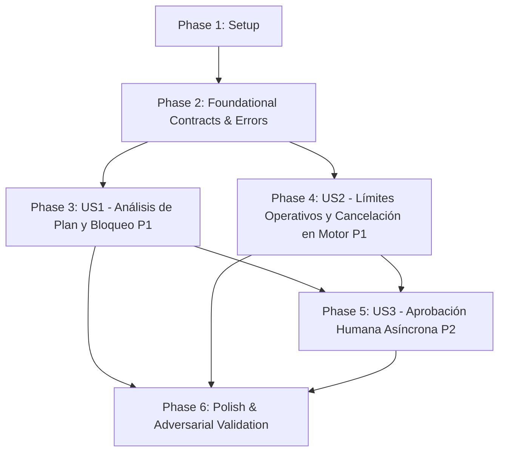

# Tasks: Control de Costo, Límites Operativos y Flujo de Aprobación Humana

**Input**: Design documents from `/specs/004-cost-limits-human-approval/`

**Prerequisites**: [plan.md](./plan.md) (required), [spec.md](./spec.md) (required for user stories), [research.md](./research.md), [data-model.md](./data-model.md), [contracts/](./contracts/)

**Tests**: Included as mandatory deliverables required by `spec.md`, the Project Constitution (Principle VI: *Desarrollo Guiado por Pruebas Adversarias*), and acceptance criteria (`SC-001` a `SC-006`).

**Organization**: Tasks are grouped by user story to enable independent implementation and testing of each story.

## Format: `[ID] [P?] [Story] Description`

- **[P]**: Can run in parallel (different files, no dependencies)
- **[Story]**: Which user story this task belongs to (e.g., `[US1]`, `[US2]`, `[US3]`)
- Includes exact file paths and verbatim data-model constraints in descriptions

## Path Conventions

- **Single modular project**: `src/contracts/`, `src/core/limits/`, `src/bin/`, `src/adapters/`, `tests/` at repository root

---

## Phase 1: Setup (Shared Infrastructure)

**Purpose**: Preparación de repositorio, scripts npm y configuración de infraestructura para límites de costo, cancelación nativa y aprobación humana.

- [X] T001 Initialize git repository and create progressive branch commit structure representing features 001 through 004 in repository root
- [X] T002 [P] Add test and CLI scripts (`test:limits`, `test:rate-limit`, `test:approval`, `cli:db-mcp`) to `package.json`
- [X] T003 [P] Verify and update TypeScript path configurations for new core limits modules in `tsconfig.json`

---

## Phase 2: Foundational (Blocking Prerequisites)

**Purpose**: Contratos formales en TypeScript estricto, errores tipados y políticas predeterminadas de control de límites que bloquean todas las historias de usuario.

**⚠️ CRITICAL**: Ninguna historia de usuario puede comenzar hasta completar esta fase.

- [X] T004 Copy and integrate formal contracts and interfaces (`RiskSeverity`, `QueryPlanRiskProfile`, `EngineRiskThresholds`, `OperationalLimitsPolicy`, `RateLimitCheckResult`, `IRateLimiter`, `ApprovalStatus`, `PendingApprovalTicket`, `ApprovedQueryResult`, `IPendingApprovalStore`, `IQueryPlanRiskEvaluator`, `IQueryExecutionSupervisor`) from `specs/004-cost-limits-human-approval/contracts/cost-limits.contract.ts` into `src/contracts/cost-limits.contract.ts`
- [X] T005 [P] Implement structured cost and operational error classes (`CostLimitExceededError`, `QueryExecutionTimeoutError`, `RateLimitExceededError`, `PendingApprovalRequiredError`) in `src/core/errors.ts`
- [X] T006 [P] Implement default operational policies and engine risk thresholds (`defaultOperationalLimitsPolicy` with `executionTimeoutMs: 5000`, `maxRowsLimit: 1000`, `rateLimitPerClientPerMinute: 60`, `rateLimitGlobalPerMinute: 300`, and `defaultEngineRiskThresholds` with `planTimeoutMs: 2000`) in `src/core/limits/default-limits-policy.ts`

**Checkpoint**: Contratos base, tipos de error y políticas por defecto listos — la implementación de historias de usuario puede comenzar.

---

## Phase 3: User Story 1 - Análisis Preventivo del Plan de Ejecución y Bloqueo de Consultas Peligrosas (Priority: P1) 🎯 MVP

**Goal**: Toda consulta `SELECT` válida es evaluada mediante su plan de ejecución (`EXPLAIN JSON` en PostgreSQL y `SHOWPLAN` en SQL Server) antes de ejecutarse; consultas con escaneos completos en tablas grandes protegidas, productos cartesianos o estimaciones desmedidas son bloqueadas automáticamente con estado `BLOCKED_BY_COST`. Si el plan falla o excede 2s, aplica política fail-safe elevando a `PENDING_APPROVAL`.

**Independent Test**: Ejecutar `npx vitest run tests/unit/limits/risk-evaluator.test.ts` comprobando el bloqueo del 100% de consultas con escaneos en tablas protegidas y joins cartesianos (`SC-001`), y la aprobación de consultas indexadas eficientes.

### Tests for User Story 1 ⚠️

- [X] T007 [P] [US1] Write unit tests for `QueryPlanRiskEvaluator` verifying detection of `hasFullScan: true` on tables listed in `largeTablesBlocklist`, `hasCartesianJoin: true`, row estimations exceeding `maxEstimatedRowsBlock` yielding `severity: 'CRITICAL_BLOCK'`, rows/cost exceeding caution thresholds yielding `severity: 'MEDIUM_CAUTION'`, and unverified plans (timeout > 2000ms or syntax error) yielding `severity: 'MEDIUM_CAUTION'` with `isVerifiable: false` in `tests/unit/limits/risk-evaluator.test.ts`

### Implementation for User Story 1

- [X] T008 [US1] Implement `QueryPlanRiskEvaluator` implementing `IQueryPlanRiskEvaluator` to normalize and evaluate query plans against `EngineRiskThresholds`, calculating `estimatedCost`, `estimatedRows`, `scannedTables`, and assigning `RiskSeverity` (`LOW`, `MEDIUM_CAUTION`, `CRITICAL_BLOCK`) with fail-safe handling in `src/core/limits/risk-evaluator.ts`
- [X] T009 [US1] Integrate `QueryPlanRiskEvaluator` into `AdapterRegistry.validateAndExplain()` and pre-execution pipeline in `src/core/engine-registry.ts`
- [X] T010 [US1] Integrate audit logging for queries blocked by execution plan risk with `status: 'BLOCKED_BY_COST'`, detailed rejection reason, and `rowCount: 0` in `src/core/limits/risk-evaluator.ts` and `src/core/audit/audit-logger.ts`

**Checkpoint**: User Story 1 completa e independientemente testeable; todas las consultas peligrosas son bloqueadas preventivamente antes de tocar los datos.

---

## Phase 4: User Story 2 - Aplicación de Límites Operativos Rigurosos y Cancelación Activa en el Motor (Priority: P1)

**Goal**: Imponer límites operativos de filas devueltas (`maxRowsLimit` con bandera `truncated: true`), control de tasa en dos niveles en memoria ($O(1)$) y temporizador de tiempo máximo de ejecución (`executionTimeoutMs`) con disparo de señal de cancelación real en el motor (`pg_cancel_backend` en PostgreSQL y `request.cancel` en SQL Server), auditando como `CANCELLED_BY_TIMEOUT`.

**Independent Test**: Ejecutar `npx vitest run tests/unit/limits/rate-limiter.test.ts` y `npx vitest run tests/unit/limits/execution-supervisor.test.ts` comprobando el rechazo de ráfagas en memoria en < 1ms, el truncamiento seguro de filas y la emisión de señales de cancelación activa al vencer el temporizador (`SC-002`, `SC-005`).

### Tests for User Story 2 ⚠️

- [X] T011 [P] [US2] Write unit tests for `TwoTierRateLimiter` verifying per-client sliding window throttling (`rateLimitPerClientPerMinute`), global server instance throttling (`rateLimitGlobalPerMinute`), $O(1)$ in-memory evaluation with rejection in < 1ms, and accurate retry-after seconds calculation in `tests/unit/limits/rate-limiter.test.ts`
- [X] T012 [P] [US2] Write unit tests for `QueryExecutionSupervisor` verifying execution timeout triggering `signal.abort()`, safe result truncation when rows exceed `maxRowsLimit` with `truncated: true`, and audit logging with `status: 'CANCELLED_BY_TIMEOUT'` in `tests/unit/limits/execution-supervisor.test.ts`

### Implementation for User Story 2

- [X] T013 [US2] Implement `TwoTierRateLimiter` implementing `IRateLimiter` with in-memory sliding timestamp windows tracking client-level and global quotas in `src/core/limits/rate-limiter.ts`
- [X] T014 [US2] Implement native query abort and cancellation handling in `PostgresAdapter.executeQuery()` invoking `SELECT pg_cancel_backend(pid)` (with `pg_terminate_backend(pid)` safety fallback after 2s grace) in `src/adapters/postgres/postgres-adapter.ts`
- [X] T015 [US2] Implement native query abort and cancellation handling in `SqlServerAdapter.executeQuery()` invoking `request.cancel()` on attention signal in `src/adapters/sqlserver/sqlserver-adapter.ts`
- [X] T016 [US2] Implement `QueryExecutionSupervisor` implementing `IQueryExecutionSupervisor` coordinating rate-limiting checks, timeout abort controllers, safe row truncation with `truncated: true`, and error mapping in `src/core/limits/execution-supervisor.ts`
- [X] T017 [US2] Integrate `QueryExecutionSupervisor` into `AdapterRegistry.validateAndExecute()` in `src/core/engine-registry.ts` and ensure cancellation audit logging in `src/core/audit/audit-logger.ts`

**Checkpoint**: User Stories 1 y 2 completas; el servidor protege la base de datos contra DoS, cancela consultas largas en el motor y aplica límites de tasa y volumen en tiempo real.

---

## Phase 5: User Story 3 - Aprobación Humana Asíncrona sin Bloqueo de Cliente (Priority: P2)

**Goal**: Consultas en zona de precaución (`MEDIUM_CAUTION`) o con planes no verificables pasan a `PENDING_APPROVAL` en almacén local atómico persistente con TTL (15 min), devolviendo respuesta inmediata al cliente MCP sin bloquear el transporte (< 500ms). Se provee la CLI de operador fuera de banda `db-mcp approve <id>` / `db-mcp reject <id>` y la herramienta MCP pasiva `get_query_result(id)` sin capacidad de auto-aprobación para la IA.

**Independent Test**: Ejecutar `npx vitest run tests/unit/limits/pending-approval-store.test.ts` y `npx vitest run tests/contract/approval-flow.test.ts` validando el ciclo completo: retención en < 500ms, imposibilidad de auto-aprobación de la IA, aprobación con CLI y entrega pasiva de resultados (`SC-003`, `SC-004`).

### Tests for User Story 3 ⚠️

- [X] T018 [P] [US3] Write unit tests for `PendingApprovalStore` verifying atomic file persistence (`write-temp-and-rename`), ticket lifecycle states (`PENDING`, `APPROVED`, `REJECTED`, `EXPIRED`), approved query result storage, and automatic TTL purge (15 minutes) in `tests/unit/limits/pending-approval-store.test.ts`
- [X] T019 [P] [US3] Write contract integration tests for the human approval flow verifying immediate return of `PENDING_APPROVAL` with `approvalId` in < 500ms, absence of any AI approval tool, operator CLI execution of `db-mcp approve`, and passive retrieval of data via `get_query_result` in `tests/contract/approval-flow.test.ts`

### Implementation for User Story 3

- [X] T020 [US3] Implement `PendingApprovalStore` implementing `IPendingApprovalStore` with atomic file persistence at `PENDING_APPROVAL_STORE_PATH` (`.db-mcp/pending_approvals.json`) and automated TTL expiration cleanup in `src/core/limits/pending-approval-store.ts`
- [X] T021 [US3] Integrate caution routing in query pipeline: when `riskProfile.severity === 'MEDIUM_CAUTION'`, generate `approvalId` (`appr_<uuid>`), persist ticket in `PendingApprovalStore`, emit `PENDING_APPROVAL` audit log, and return structured risk summary to client without blocking in `src/core/engine-registry.ts`
- [X] T022 [US3] Implement operator administrative CLI tool `db-mcp` supporting commands `list-pending`, `approve <approvalId> [--reason <text>]`, and `reject <approvalId> [--reason <text>]` in `src/bin/db-mcp.ts`
- [X] T023 [US3] Implement passive read-only MCP tool `get_query_result` accepting `{ approvalId: string }` and returning approved results with zero-trust encapsulation or current ticket status without any approval capability in `src/index.ts`

**Checkpoint**: Todas las historias de usuario (US1, US2, US3) completadas y totalmente funcionales.

---

## Phase 6: Polish & Cross-Cutting Concerns

**Purpose**: Verificación cruzada, pruebas adversarias de sobrecarga y validación de escenarios de inicio rápido.

- [X] T024 [P] Implement adversarial DoS attack test suite verifying resilience against complex Cartesian product patterns, rapid rate-limit saturations, and concurrent timeout aborts in `tests/adversarial/cost-dos.test.ts`
- [X] T025 Execute end-to-end quickstart validation scenarios 1 through 6 from `specs/004-cost-limits-human-approval/quickstart.md`
- [X] T026 [P] Verify code quality, run full test suite (`npm test`), ensure zero TypeScript compilation errors in `strict: true` mode, and commit progressive feature branches in git

---

## Dependencies & Execution Order

### Phase Dependencies

- **Setup (Phase 1)**: Sin dependencias — inicialización de git y scripts npm.
- **Foundational (Phase 2)**: Depende de Setup — **BLOQUEA** todas las historias de usuario.
- **User Story 1 (Phase 3)**: Depende de Foundational — puede comenzar inmediatamente.
- **User Story 2 (Phase 4)**: Depende de Foundational — implementa límites y supervisión de ejecución.
- **User Story 3 (Phase 5)**: Depende de US1 (detección de precaución) y Foundational (almacén de tickets).
- **Polish (Phase 6)**: Depende de la finalización de US1, US2 y US3.

### User Story Completion Graph



### Parallel Opportunities

- **Setup**: `T002` y `T003` pueden ejecutarse en paralelo tras `T001`.
- **Foundational**: `T005` y `T006` pueden desarrollarse en paralelo con `T004`.
- **User Story 1**: `T007` (tests) se escribe primero en paralelo antes de la implementación `T008`.
- **User Story 2**: `T011` y `T012` (tests) pueden ejecutarse en paralelo; `T014` (PostgreSQL) y `T015` (SQL Server) son completamente independientes.
- **User Story 3**: `T018` y `T019` (tests) pueden desarrollarse en paralelo; `T022` (CLI de operador) y `T023` (tool MCP pasivo) pueden implementarse en paralelo.

---

## Parallel Example: User Story 2

```bash
# Escribir pruebas unitarias en paralelo:
Task: "T011 [P] [US2] Write unit tests for TwoTierRateLimiter in tests/unit/limits/rate-limiter.test.ts"
Task: "T012 [P] [US2] Write unit tests for QueryExecutionSupervisor in tests/unit/limits/execution-supervisor.test.ts"

# Implementar cancelaciones nativas independientes por motor:
Task: "T014 [US2] Implement native query abort in PostgresAdapter in src/adapters/postgres/postgres-adapter.ts"
Task: "T015 [US2] Implement native query abort in SqlServerAdapter in src/adapters/sqlserver/sqlserver-adapter.ts"
```

---

## Implementation Strategy

### MVP First (User Story 1 Only)
1. Completar Phase 1: Setup.
2. Completar Phase 2: Foundational (contratos y errores).
3. Completar Phase 3: User Story 1 (evaluación de planes de ejecución y bloqueo `BLOCKED_BY_COST`).
4. **Validar MVP**: Probar bloqueo automático de escaneos y joins cartesianos con `npx vitest run tests/unit/limits/risk-evaluator.test.ts`.

### Entrega Incremental
1. **MVP (US1)**: Bloqueo preventivo de consultas destructivas por análisis de planes.
2. **Incremento 2 (US2)**: Cancelación activa en el motor (`pg_cancel_backend` / `request.cancel`), truncamiento con `truncated: true` y rate limiting híbrido en dos niveles.
3. **Incremento 3 (US3)**: Flujo de aprobación humana asíncrono con persistencia atómica local, comando CLI `db-mcp approve` y tool pasivo `get_query_result`.
4. **Cierre (Polish)**: Batería adversaria de DoS y validación de escenarios de inicio rápido.
