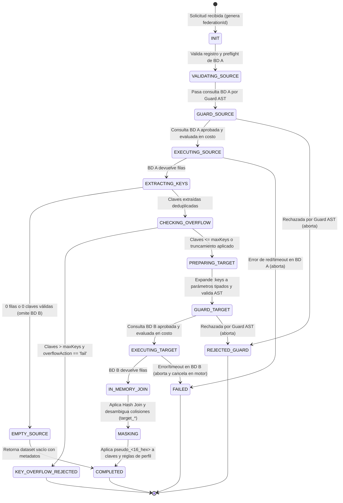

# Data Model: Orquestador de Consulta Federada Segura

**Feature**: `006-secure-federated-query`
**Date**: 2026-10-30
**Status**: Completed

## 1. Entities & Data Structures

### 1.1 FederatedOperation

Representa la instancia del ciclo de vida de una ejecución federada completa coordinada por el proceso MCP.

| Campo | Tipo | Obligatorio | Descripción |
|---|---|---|---|
| `federationId` | `string` (UUID v4) | Sí | Identificador único de correlación transversal para toda la operación. |
| `sourceAdapterId` | `string` | Sí | Identificador del adaptador origen (BD A) registrado en `AdapterRegistry`. |
| `targetAdapterId` | `string` | Sí | Identificador del adaptador destino (BD B) registrado en `AdapterRegistry`. |
| `sourceKeyColumn` | `string` | Sí | Nombre de la columna de clave simple a extraer en los resultados de BD A. |
| `targetJoinColumn` | `string` | Sí | Nombre de la columna de unión simple correspondiente en BD B. |
| `joinType` | `'LEFT' \| 'INNER'` | Sí | Tipo de cruce en memoria a aplicar (por defecto `'LEFT'`). |
| `maxKeys` | `number` | Sí | Límite máximo de claves a extraer e inyectar (por defecto 500, rango 1-1000). |
| `overflowAction` | `'truncate' \| 'fail'` | Sí | Comportamiento si las claves extraídas exceden `maxKeys` (por defecto `'truncate'`). |
| `status` | `FederatedOperationStatus` | Sí | Estado actual de la máquina de estados federada. |
| `startedAt` | `string` (ISO 8601) | Sí | Marca temporal de inicio de la orquestación. |
| `completedAt` | `string` (ISO 8601) | No | Marca temporal de finalización de la orquestación. |

### 1.2 FederatedKeySet

Estructura de datos transitoria en memoria utilizada para sanitizar y encapsular las claves extraídas de BD A antes de la inyección en BD B.

| Campo | Tipo | Obligatorio | Descripción |
|---|---|---|---|
| `keyColumn` | `string` | Sí | Nombre de la columna origen de donde provienen las claves. |
| `rawCount` | `number` | Sí | Cantidad total de filas leídas de BD A. |
| `uniqueKeys` | `Array<string \| number>` | Sí | Conjunto deduplicado de claves no nulas tratadas como datos no confiables. |
| `nullCount` | `number` | Sí | Cantidad de claves nulas filtradas y descartadas. |
| `isTruncated` | `boolean` | Sí | `true` si la cantidad de claves únicas superó el tope `maxKeys`. |
| `totalAvailableKeys` | `number` | Sí | Total de claves únicas no nulas encontradas antes del truncamiento. |

### 1.3 SessionPseudonymContext

Contexto criptográfico efímero en memoria volátil vinculado a la sesión activa del servidor MCP.

| Campo | Tipo | Obligatorio | Descripción |
|---|---|---|---|
| `sessionId` | `string` | Sí | Identificador de la sesión MCP activa. |
| `ephemeralSalt` | `Buffer` (32 bytes) | Sí | Salt criptográfico aleatorio generado en arranque de sesión. Nunca sale de memoria. |
| `cache` | `Map<string, string>` | Sí | Caché en memoria para reutilizar el pseudónimo calculado en valores idénticos repetidos. |

### 1.4 FederatedQueryRequest & FederatedQueryResponse

Estructura de la interfaz de la herramienta MCP `execute_federated_query`.

#### Request Schema
```typescript
interface FederatedQueryRequest {
  sourceAdapterId: string;
  sourceSql: string;
  sourceKeyColumn: string;
  targetAdapterId: string;
  targetSqlTemplate: string; // Debe incluir la cláusula "WHERE ... IN (:keys)"
  targetJoinColumn: string;
  joinType?: 'LEFT' | 'INNER'; // Default: 'LEFT'
  maxKeys?: number;           // Default: 500
  overflowAction?: 'truncate' | 'fail'; // Default: 'truncate'
}
```

#### Response Schema
```typescript
interface FederatedQueryResponse {
  federationId: string;
  status: 'SUCCESS' | 'EMPTY_SOURCE' | 'TRUNCATED_KEYS';
  joinType: 'LEFT' | 'INNER';
  totalSourceRows: number;
  totalTargetRows: number;
  totalMergedRows: number;
  keysProcessed: number;
  keysTruncated: boolean;
  totalAvailableKeys: number;
  columns: Array<{ name: string; type: string }>;
  rows: Array<Record<string, unknown>>;
  maskedColumns: string[];
  executionTimeMs: number;
  warnings?: string[];
}
```

---

## 2. State Machine & Transitions



---

## 3. Validation Rules & Invariants

1. **Invariante de Solo Lectura**:
   - Toda consulta enviada tanto a BD A como a BD B debe tener como nodo raíz un único `SELECT`.
   - Ninguna consulta puede contener comentarios (`--`, `/* */`), sentencias encadenadas (`;`), CTEs mutantes (`WITH ... AS (INSERT...)`), `SELECT INTO` ni llamadas a procedimientos.
2. **Invariante de Cero Confianza en Parámetros**:
   - Ningún valor de `uniqueKeys` extraído de BD A puede concatenarse en el texto SQL de BD B.
   - Todo valor debe viajar en el arreglo de parámetros tipados (`parameters: unknown[]`) del `ParameterizedQuery`.
3. **Invariante de Límite de Parámetros**:
   - El número de parámetros inyectados en BD B nunca puede exceder `maxKeys` (acotado formalmente entre 1 y 1000, por defecto 500).
4. **Invariante de Privacidad de Datos en Tránsito**:
   - En la serialización final hacia el cliente MCP, toda celda correspondiente a las columnas sensibles de cruce (`sourceKeyColumn`, `targetJoinColumn`) debe presentar el formato `pseudo_<16_hex>`.
   - El dato crudo original nunca debe aparecer en el JSON devuelto ni en el log de auditoría.
5. **Invariante de Trazabilidad Forense**:
   - Cada transición de estado que involucre ejecución o rechazo debe registrar un evento de auditoría estructurado cuyo campo `correlationId` sea idéntico al `federationId`.
