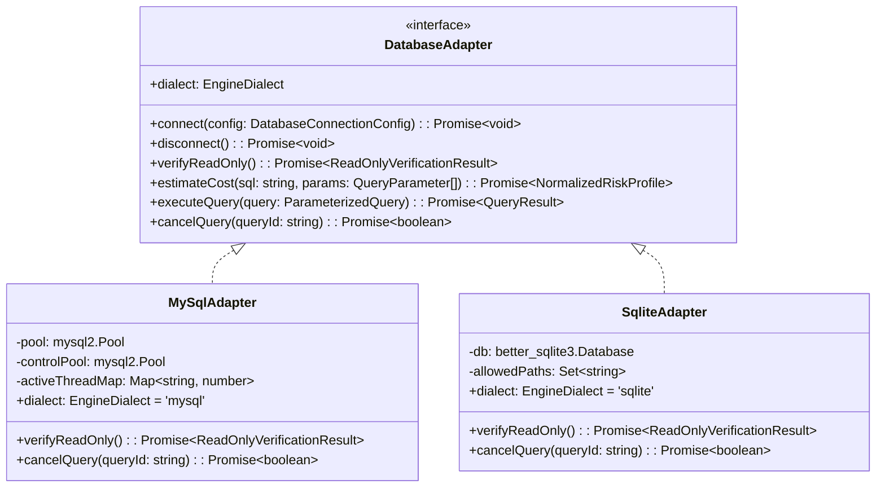
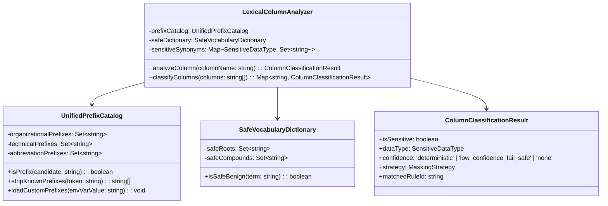
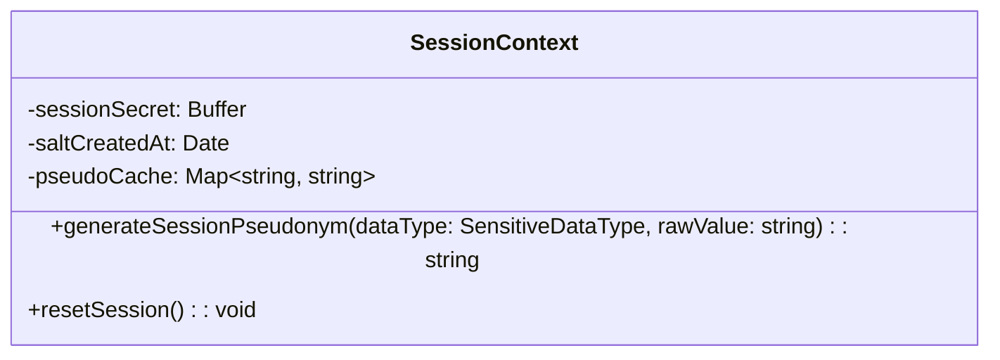
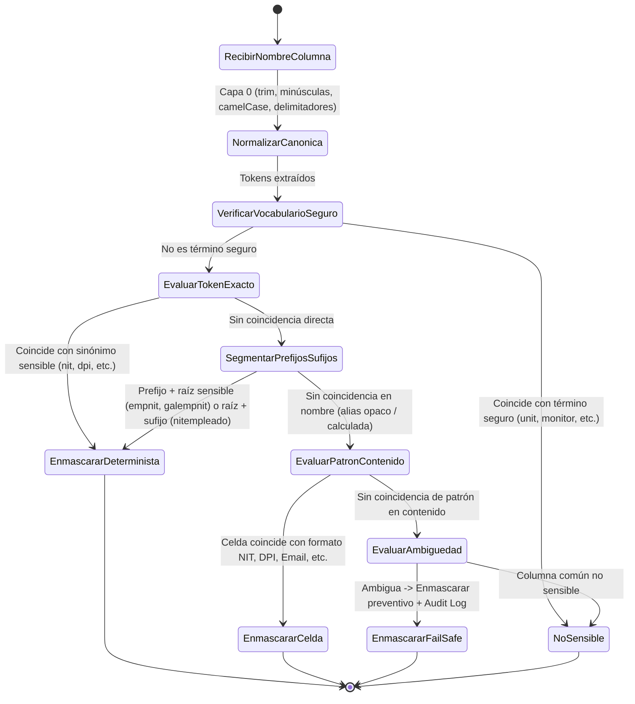

# Data Model: Conectores MySQL/MariaDB, SQLite y Enmascaramiento Robusto de Variaciones Sensibles

**Feature**: `007-mysql-sqlite-robust-masking`
**Date**: 2026-11-02
**Status**: Completed

---

## 1. Entidades del Dominio

### 1.1 `DatabaseAdapter` (Ampliación para MySQL/MariaDB y SQLite)
Representa la abstracción de conexión y ejecución de solo lectura para los nuevos motores soportados, implementando el contrato formal `DatabaseAdapter`.

#### Atributos y Reglas de Validación
- **`MySqlAdapter`**:
  - `dialect`: `'mysql'` | `'mariadb'`.
  - `activeThreadMap`: Mapeo de `queryId` a `connection.threadId` para habilitar `KILL QUERY` en menos de 500 ms.
  - Validación de arranque (*Preflight Check*): Consulta `SELECT privilege_type FROM information_schema.user_privileges` y rechaza la conexión si detecta privilegios de mutación (`INSERT`, `UPDATE`, `DELETE`, `DROP`, `ALTER`, `GRANT`, `SUPER`).
  - `sql_mode`: Forzado obligatorio en handshake a `'STRICT_ALL_TABLES,NO_ENGINE_SUBSTITUTION'`.
- **`SqliteAdapter`**:
  - `dialect`: `'sqlite'`.
  - `filePath`: Ruta absoluta hacia el archivo `.db`, `.sqlite` o `.sqlite3`.
  - Validación de arranque (*Preflight Check*):
    - Comprueba que la ruta resuelta canónicamente coincida con la lista blanca permitida (`SQLITE_ALLOWED_DIRECTORIES` o `allowedPaths`).
    - Comprueba permisos de solo lectura del archivo en el sistema de archivos (`fs.constants.R_OK`).
    - Rechaza categóricamente cadenas `:memory:` o archivos no existentes (`fileMustExist: true`).
    - Apertura en modo estricto de solo lectura (`SQLITE_OPEN_READONLY`).

---

### 1.2 `LexicalColumnAnalyzer` y `UnifiedPrefixCatalog`
Componente responsable de clasificar nombres de columna de forma determinista para prevenir fuga de datos personales o fiscales.

#### Atributos y Reglas de Clasificación
- **`UnifiedPrefixCatalog`**:
  - `organizationalPrefixes`: `{'emp', 'gal', 'cli', 'prov', 'usr', 'cust', 'tit', 'cta', 'dep', 'suc', 'doc'}`
  - `technicalPrefixes`: `{'t1', 'col', 'v', 'tbl'}`
  - `abbreviationPrefixes`: `{'no', 'num', 'nro', 'id', 'tax'}`
  - Extensible en tiempo de ejecución con `MASKING_CUSTOM_PREFIXES` (lista separada por comas).
- **`SafeVocabularyDictionary`**:
  - Términos benignos conocidos con subcadenas que podrían confundirse:
    `{'unit', 'units', 'unit_price', 'monitor', 'benito', 'manito', 'definition', 'unanimity', 'nitrate', 'ignite', 'granite', 'thumbnail', 'chainmail', 'cocktail', 'celebrity_id', 'salient_feature', 'salad_type', 'dpid', 'rapid_build'}`.
  - Regla: Si un token o palabra compuesta coincide con el vocabulario seguro, se clasifica como `no_sensible` con 0 % de falsos positivos.
- **`ColumnClassificationResult`**:
  - `isSensitive`: Booleano determinista.
  - `dataType`: `'nit' | 'dpi' | 'email' | 'phone' | 'amount' | 'custom' | 'none'`. ('amount' es el tipo canónico para salarios y montos).
  - `confidence`:
    - `'none'`: Términos pertenecientes al `SafeVocabularyDictionary` o nombres sin indicios sensibles (0 % falsos positivos garantizado; NUNCA entra a fail-safe).
    - `'deterministic'`: Coincidencia léxica exacta o segmentada con raíces sensibles conocidas.
    - `'low_confidence_fail_safe'`: Nombres no catalogados en el vocabulario seguro con indicios morfológicos ambiguos; se enmascara preventivamente en memoria y se audita como `low_confidence_match`.

---

### 1.3 Validación de Contenido Celda a Celda (Segunda Línea de Defensa)
Para columnas con alias opacos o funciones calculadas (`SELECT empnit AS cod`, `CONCAT(...)`), se aplica la función `isValidNitContent(value)`:
- Requiere formato estructurado con guion obligatorio `\b\d{2,8}-[0-9kK]\b`, O
- Para valores continuos de 6 a 10 dígitos, exige validación satisfactoria del algoritmo Módulo 11 de la SAT guatemalteca (`validateNitChecksumModulo11`), evitando que enteros ordinarios (años como 2024, códigos postales o secuencias numéricas generales) disparen falsos positivos.
- **Regla Inquebrantable**: La señal de contenido NUNCA puede anular ni des-enmascarar una columna clasificada como sensible por su nombre.

---

### 1.4 `SessionContext`
Entorno efímero del proceso MCP que garantiza pseudonimización determinista por sesión (Principio IV).

#### Atributos y Reglas de Sesión
- **`sessionSecret`**: Semilla criptográfica aleatoria de 32 bytes (`crypto.randomBytes(32)`).
- **`generateSessionPseudonym(dataType, rawValue)`**:
  - Calcula `HMAC-SHA256(sessionSecret, rawValue.trim().toLowerCase())`.
  - Retorna `pseudo_${dataType}_${hash.slice(0, 16)}`.
  - Persiste el resultado en `pseudoCache` durante la vida del proceso para evitar recálculos en consultas federadas masivas.
- **Ciclo de vida**: Creado en memoria al levantar el proceso Node.js; se destruye al apagar el servidor.

---

## 2. Flujo de Transiciones y Ciclo de Vida

