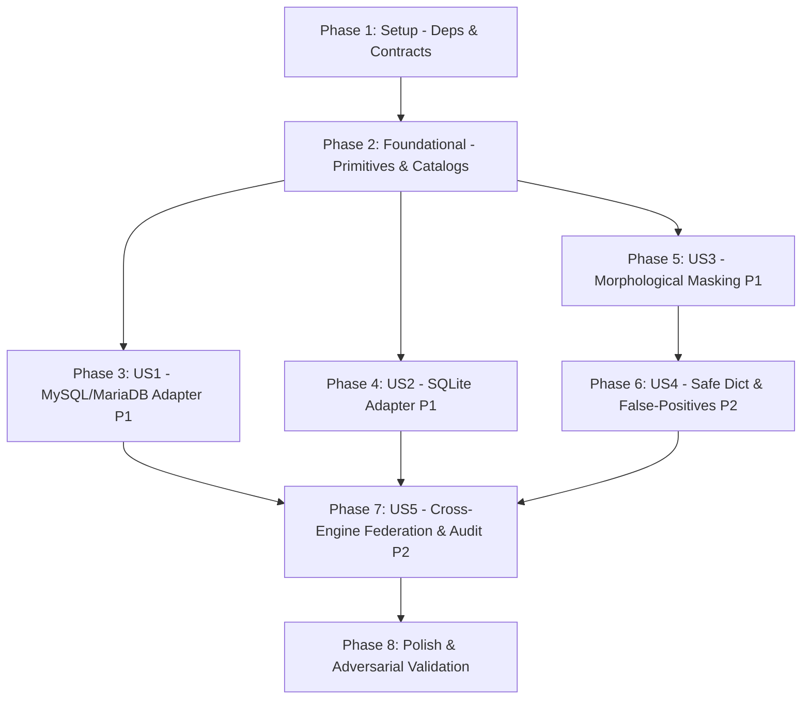

# Tasks: Conectores MySQL/MariaDB, SQLite y Enmascaramiento Robusto de Variaciones Sensibles

**Input**: Design documents from `/specs/007-mysql-sqlite-robust-masking/`
**Prerequisites**: [plan.md](./plan.md) (required), [spec.md](./spec.md) (required for user stories), [research.md](./research.md), [data-model.md](./data-model.md), [contracts/](./contracts/), [quickstart.md](./quickstart.md)
**Constitution Compliance**: Verified under [constitution.md](../../.specify/memory/constitution.md) (Principles I to VII: Unbreakable Read-Only, Defense in Depth, Zero-Trust Data Handling, In-Memory Privacy, Immutable Audit, Adversarial Testing, Contract Decoupling).

## Format: `- [ ] [TaskID] [P?] [Story?] Description with file path`

- **[P]**: Can run in parallel (different files, no dependencies)
- **[Story]**: User story mapping (`[US1]`, `[US2]`, `[US3]`, `[US4]`, `[US5]`)
- Exact file paths specified in every task description

---

## Phase 1: Setup (Dependencies & Shared Contracts)

**Purpose**: Project initialization, runtime dependencies, and core contract definitions.

- [X] T001 Add `mysql2` and `better-sqlite3` runtime dependencies and `@types/better-sqlite3` in `package.json`
- [X] T002 [P] Extend `EngineDialect` to include `'mysql' | 'mariadb' | 'sqlite'` in `src/contracts/database-adapter.ts`
- [X] T003 [P] Extend `SensitiveDataType` with `'nit'` (preserving `'amount'` for salaries and monetary values) in `src/contracts/security.contract.ts`
- [X] T004 [P] Define `UnifiedPrefixConfig` and `ColumnClassificationResult` interfaces in `src/contracts/security.contract.ts`
- [X] T005 [P] Define `MySqlConnectionConfigSchema` and `SqliteConnectionConfigSchema` in `src/contracts/database-adapter.ts`

---

## Phase 2: Foundational (Core Primitives & Base Dictionaries)

**Purpose**: Shared infrastructure and security primitives that MUST be complete before user stories begin.

**⚠️ CRITICAL**: No user story implementation can begin until this phase is complete.

- [X] T006 Implement `UnifiedPrefixCatalog` consolidating organizational, technical, and abbreviation prefixes with `MASKING_CUSTOM_PREFIXES` support in `src/core/security/unified-prefix-catalog.ts`
- [X] T007 [P] Implement `SafeVocabularyDictionary` with benign roots and compounds (`unit`, `unit_price`, `monitor`, `benito`, etc.) in `src/core/security/safe-vocabulary-dict.ts`
- [X] T008 [P] Implement Guatemalan SAT Modulo 11 check-digit algorithm `validateNitChecksumModulo11` and `isValidNitContent` in `src/core/security/masking-rules.ts`
- [X] T009 [P] Implement `formatMaskedNit` supporting partial masking (`*******-4` / `******-K`), redact, and session pseudonym in `src/core/security/masking-rules.ts`
- [X] T010 [P] Implement `SessionContext` managing ephemeral 32-byte in-memory salt and deterministic HMAC-SHA256 pseudonym generation in `src/core/security/session-pseudonym.ts`
- [X] T011 Extend `AdapterRegistry` to support dialect registration for `'mysql'`, `'mariadb'`, and `'sqlite'` in `src/core/engine-registry.ts`

**Checkpoint**: Foundation ready - user story implementation and testing can now proceed.

---

## Phase 3: User Story 1 - Conectividad Segura y Consultas de Solo Lectura en MySQL y MariaDB (Priority: P1) 🎯 MVP

**Goal**: Connect MySQL and MariaDB databases under strict read-only guarantees, enforcing `sql_mode = 'STRICT_ALL_TABLES,NO_ENGINE_SUBSTITUTION'`, AST Guard validation, and reactive cancellation via `KILL QUERY <threadId>` in ≤ 500 ms.

**Independent Test**: Connect to MySQL/MariaDB with read-only user, execute `SELECT` queries, verify write queries and multi-statements are rejected, and verify `SLEEP(10)` query cancellation completes in ≤ 500 ms.

### Tests for User Story 1 ⚠️

> **NOTE: Write these tests FIRST, ensure they FAIL before implementation**

- [X] T012 [P] [US1] Create contract and preflight tests verifying read-only enforcement and rejection of write privileges in `tests/contract/mysql-adapter.spec.ts`
- [X] T013 [P] [US1] Create cancellation unit test verifying `KILL QUERY <threadId>` terminates queries in ≤ 500 ms in `tests/unit/mysql-cancellation.spec.ts`

### Implementation for User Story 1

- [X] T014 [P] [US1] Implement `verifyMySqlReadOnly` preflight gate inspecting `information_schema.user_privileges` in `src/adapters/mysql/mysql-preflight.ts`
- [X] T015 [P] [US1] Implement `MySqlQueryWatchdog` managing control connection pool, thread mappings, and `KILL QUERY <threadId>` execution in `src/adapters/mysql/mysql-cancellation.ts`
- [X] T016 [US1] Implement `MySqlAdapter` implementing `DatabaseAdapter` with connection handshake forcing `sql_mode = 'STRICT_ALL_TABLES,NO_ENGINE_SUBSTITUTION'`, AST guard validation, and watchdog integration in `src/adapters/mysql/mysql-adapter.ts` (depends on T014, T015)
- [X] T017 [US1] Register `MySqlAdapter` in engine registry and export adapter in `src/adapters/mysql/index.ts` (depends on T016)

**Checkpoint**: User Story 1 functional and independently testable against MySQL and MariaDB instances.

---

## Phase 4: User Story 2 - Conectividad de Solo Lectura y Aislamiento para SQLite (Priority: P1)

**Goal**: Connect persistent local SQLite files with mandatory `SQLITE_OPEN_READONLY`, directory whitelist verification, rejection of `:memory:`, and AST Guard validation.

**Independent Test**: Connect to a `.sqlite` file within the whitelist, execute `SELECT` queries, verify `:memory:` and paths outside whitelist are rejected, and verify mutating statements are blocked.

### Tests for User Story 2 ⚠️

> **NOTE: Write these tests FIRST, ensure they FAIL before implementation**

- [X] T018 [P] [US2] Create contract tests for SQLite preflight check, directory whitelist, `:memory:` rejection, and read-only enforcement in `tests/contract/sqlite-adapter.spec.ts`

### Implementation for User Story 2

- [X] T019 [P] [US2] Implement `verifySqlitePathAndPermissions` checking canonical path against `SQLITE_ALLOWED_DIRECTORIES`, OS read permissions, and rejecting `:memory:` in `src/adapters/sqlite/sqlite-preflight.ts`
- [X] T020 [P] [US2] Implement SQLite AST guard validation restricting dangerous pragmas and write operations in `src/adapters/sqlite/sqlite-security.ts`
- [X] T021 [US2] Implement `SqliteAdapter` on `better-sqlite3` with `readonly: true`, `fileMustExist: true`, cost estimation, and `db.interrupt()` cancellation on abort signal in `src/adapters/sqlite/sqlite-adapter.ts` (depends on T019, T020)
- [X] T022 [US2] Register `SqliteAdapter` in engine registry and export adapter in `src/adapters/sqlite/index.ts` (depends on T021)

**Checkpoint**: User Stories 1 AND 2 both work independently under strict read-only guarantees.

---

## Phase 5: User Story 3 - Detección Robusta y Segmentación Morfológica de Columnas Sensibles (Priority: P1)

**Goal**: Segment continuous and compound column names without delimiters (`empnit`, `galempnit`, `clinit`, `nitempleado`, `nitno`) and detect 100% of sensitive cases in `corpus/column-name-sensitivity-corpus.json`.

**Independent Test**: Run unit tests on `LexicalColumnAnalyzer` against `corpus/column-name-sensitivity-corpus.json` and verify that 100% of cases labeled `sensible` are detected and masked.

### Tests for User Story 3 ⚠️

> **NOTE: Write these tests FIRST, ensure they FAIL before implementation**

- [X] T023 [P] [US3] Create unit tests for `UnifiedPrefixCatalog` prefix stripping and compound segmentation in `tests/unit/unified-prefix-catalog.spec.ts`
- [X] T024 [P] [US3] Create black-box evaluation test against `corpus/column-name-sensitivity-corpus.json` verifying 100% detection of `sensible` cases in `tests/unit/lexical-column-analyzer.spec.ts`

### Implementation for User Story 3

- [X] T025 [US3] Implement `LexicalColumnAnalyzer` with canonical normalization (Capa 0), exact token dictionary (Capa 1), and continuous concatenation segmentation (Capa 2) using `UnifiedPrefixCatalog` in `src/core/security/lexical-column-analyzer.ts` (depends on T006, T007)
- [X] T026 [US3] Add `col-nit` rule and content pattern rule `pat-nit` to `DEFAULT_MASKING_RULES` in `src/core/security/default-masking-profile.ts` (depends on T009)
- [X] T027 [US3] Integrate `LexicalColumnAnalyzer` into `DataMaskingEngine` ensuring detected sensitive columns are masked in memory before response serialization in `src/core/security/data-masking-engine.ts` (depends on T025, T026)

**Checkpoint**: User Stories 1, 2, and 3 functional; continuous concatenations like `galempnit` are deterministically masked.

---

## Phase 6: User Story 4 - Discriminación Léxica y Prevención Absoluta de Falsos Positivos (Priority: P2)

**Goal**: Guarantee 0% false positives on legitimate business columns (`unit`, `unit_price`, `monitor`, `benito`, `definition`, `nitrate`, `ignite`, `granite`, etc.) and establish strict boundary logic between `none`, `deterministic`, and `low_confidence_fail_safe`.

**Independent Test**: Run unit tests against all `no_sensible` cases in `corpus/column-name-sensitivity-corpus.json` and verify 0% false positives, with benign columns retaining raw values intact.

### Tests for User Story 4 ⚠️

> **NOTE: Write these tests FIRST, ensure they FAIL before implementation**

- [X] T028 [P] [US4] Create unit test verifying `SafeVocabularyDictionary` immediately classifies benign terms as `no_sensible` in `tests/unit/safe-vocabulary-dict.spec.ts`
- [X] T029 [P] [US4] Create unit test verifying three-state confidence boundaries (`none`, `deterministic`, `low_confidence_fail_safe`) in `tests/unit/lexical-boundary-states.spec.ts`

### Implementation for User Story 4

- [X] T030 [US4] Enforce short-circuit rule in `LexicalColumnAnalyzer`: if token matches `SafeVocabularyDictionary`, classify immediately as `confidence: 'none'` (0% false positives guaranteed, never entering fail-safe) in `src/core/security/lexical-column-analyzer.ts`
- [X] T031 [US4] Implement `low_confidence_fail_safe` policy in `DataMaskingEngine`: mask preventively in memory and emit audit entry with reason `low_confidence_match` without exposing raw cell data in `src/core/security/data-masking-engine.ts`
- [X] T032 [US4] Enforce non-downgrade rule in `DataMaskingEngine`: cell content evaluation can NEVER unmask or downgrade a column classified as sensitive by name in `src/core/security/data-masking-engine.ts`

**Checkpoint**: User Stories 1, 2, 3, and 4 work together; 100% recall on sensitive columns and 0% false positives on benign columns verified.

---

## Phase 7: User Story 5 - Enmascaramiento Uniforme en Consultas Directas, Federadas, Introspección y Auditoría (Priority: P2)

**Goal**: Deliver cross-engine masking consistency: cell-level content fallback with Modulo 11 check-digit verification, federated joins between MySQL and SQLite, schema introspection with semantic tags and no raw samples, and audit logging without raw PII.

**Independent Test**: Execute federated query between SQLite and MySQL verifying masked output, run `describe_table` on `galempnit` verifying `sample_values: []`, and verify `audit.jsonl` contains zero raw NIT values.

### Tests for User Story 5 ⚠️

> **NOTE: Write these tests FIRST, ensure they FAIL before implementation**

- [X] T033 [P] [US5] Create unit test for cell-level fallback evaluating Guatemalan SAT Modulo 11 verification (`SELECT empnit AS cod`) and ignoring general integers (e.g. 2024) in `tests/unit/data-masking-fallback.spec.ts`
- [X] T034 [P] [US5] Create contract test for cross-engine federated query between SQLite and MySQL with uniform NIT masking in `tests/contract/federated-masking-consistency.spec.ts`
- [X] T035 [P] [US5] Create contract test for `describe_table` and `introspect_schema` verifying `sensitive_type: "nit"`, `is_masked: true`, and `sample_values` strictly omitted in `tests/contract/mcp-discovery.spec.ts`
- [X] T036 [P] [US5] Create unit test verifying `audit.jsonl` logs queries with `masked_columns` and zero raw sensitive values across MySQL and SQLite in `tests/unit/audit-no-raw-pii-multi-engine.spec.ts`

### Implementation for User Story 5

- [X] T037 [US5] Implement cell-level content inspection in `DataMaskingEngine` using `isValidNitContent` (hyphenated format or Modulo 11 checksum) for unrecognized column names in `src/core/security/data-masking-engine.ts` (depends on T008)
- [X] T038 [US5] Update `CatalogIntrospector` to evaluate column names with `LexicalColumnAnalyzer`, enrich metadata with `sensitive_type` and `is_masked: true`, and delete `sample_values` for sensitive columns in `src/core/discovery/catalog-introspector.ts` (depends on T025)
- [X] T039 [US5] Expose enriched column metadata in MCP tools `describe_table` and `introspect_schema` in `src/core/tools/introspection-tools.ts` (depends on T038)
- [X] T040 [US5] Integrate `MySqlAdapter` and `SqliteAdapter` into `FederatedQueryOrchestrator` ensuring uniform typed parameter binding and session pseudonymization in `src/core/federation/federated-orchestrator.ts` (depends on T016, T021)
- [X] T041 [US5] Update structured audit logger to record `masked_columns` and sanitize query error messages in `src/core/audit/audit-logger.ts`

**Checkpoint**: All 5 user stories are completely implemented, testable, and verified across all engines and surfaces.

---

## Phase 8: Polish & Cross-Cutting Concerns

**Purpose**: Multi-engine adversarial security hardening, end-to-end quickstart validation, and typecheck verification.

- [X] T042 [P] Create multi-engine adversarial test suite executing corpus attacks (`corpus/adversarial-attacks.json`) against MySQL and SQLite in `tests/adversarial/adversarial-suite-multi-engine.spec.ts`
- [X] T043 [P] Update CLI options and environment variable loading (`SQLITE_ALLOWED_DIRECTORIES`, `MASKING_CUSTOM_PREFIXES`, MySQL env vars) in `src/bin/db-mcp.ts`
- [X] T044 Update documentation in `README.md` and `docs/` reflecting MySQL, MariaDB, SQLite support and NIT masking configuration
- [X] T045 Execute full quickstart validation scenarios (Escenarios 1 al 6) per `specs/007-mysql-sqlite-robust-masking/quickstart.md`
- [X] T046 Run full TypeScript strict typecheck (`npm run typecheck`) and build verification (`npm run build`)

---

## Dependencies & Execution Order

### Phase Dependencies



### User Story Dependencies

- **User Story 1 (P1)**: Depends on Phase 2 (Foundational). Independent of other user stories.
- **User Story 2 (P1)**: Depends on Phase 2 (Foundational). Independent of US1 and US3.
- **User Story 3 (P1)**: Depends on Phase 2 (Foundational). Independent of US1 and US2.
- **User Story 4 (P2)**: Depends on US3 (`LexicalColumnAnalyzer`).
- **User Story 5 (P2)**: Integrates US1 (MySQL), US2 (SQLite), and US4 (Masking Engine); depends on US1, US2, and US4.

---

## Parallel Opportunities

```bash
# Phase 1 Parallel Setup:
Task T002: "Extend EngineDialect in src/contracts/database-adapter.ts"
Task T003: "Extend SensitiveDataType in src/contracts/security.contract.ts"
Task T004: "Define UnifiedPrefixConfig in src/contracts/security.contract.ts"
Task T005: "Define MySql/Sqlite ConnectionConfigSchema in src/contracts/database-adapter.ts"

# Phase 2 Parallel Primitives:
Task T007: "Implement SafeVocabularyDictionary in src/core/security/safe-vocabulary-dict.ts"
Task T008: "Implement validateNitChecksumModulo11 in src/core/security/masking-rules.ts"
Task T009: "Implement formatMaskedNit in src/core/security/masking-rules.ts"
Task T010: "Implement SessionContext in src/core/security/session-pseudonym.ts"

# Independent User Story Parallel Execution:
Story US1 (Developer A): Tasks T012 - T017 (MySQL Adapter & Cancellation)
Story US2 (Developer B): Tasks T018 - T022 (SQLite Adapter & Whitelist)
Story US3 (Developer C): Tasks T023 - T027 (Morphological Analyzer & Continuous Concatenations)
```

---

## Implementation Strategy

### MVP First (User Story 1 + Story 3 Core)
1. Complete **Phase 1: Setup** (T001 - T005).
2. Complete **Phase 2: Foundational** (T006 - T011).
3. Complete **Phase 3: User Story 1** (T012 - T017) → Read-only MySQL/MariaDB with watchdog cancellation works.
4. **VALIDATE**: Run `npm run test -- tests/contract/mysql-adapter.spec.ts tests/unit/mysql-cancellation.spec.ts`.

### Incremental Delivery
1. Add **User Story 2 (SQLite)** (T018 - T022) → Test independently.
2. Add **User Story 3 (Morphological Masking & NIT)** (T023 - T027) → 100% recall on sensitive corpus.
3. Add **User Story 4 (False-Positive Elimination)** (T028 - T032) → 0% false positives on benign vocabulary.
4. Add **User Story 5 (Federation & Audit Consistency)** (T033 - T041) → Cross-engine join and zero PII leaks in audit.
5. Execute **Phase 8: Polish** (T042 - T046) → Adversarial tests pass on all engines.
